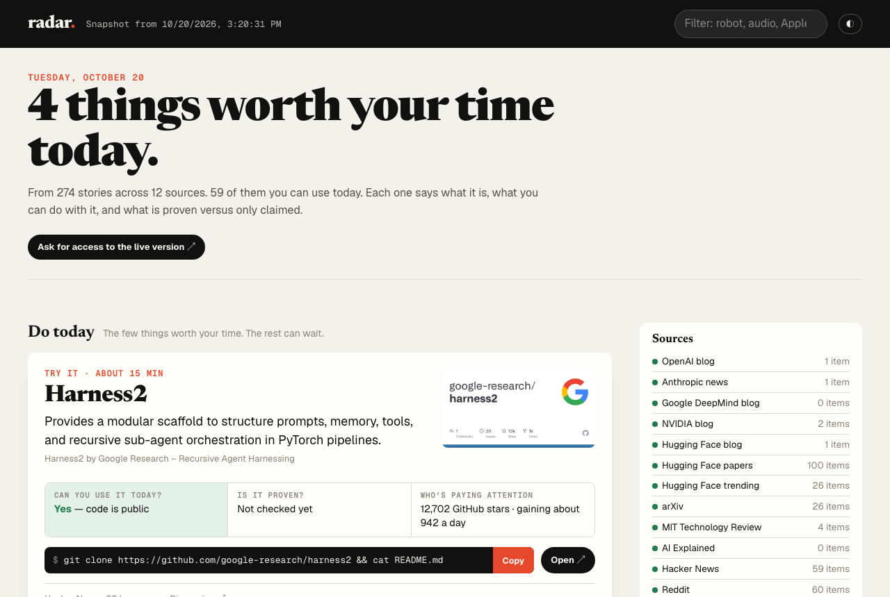
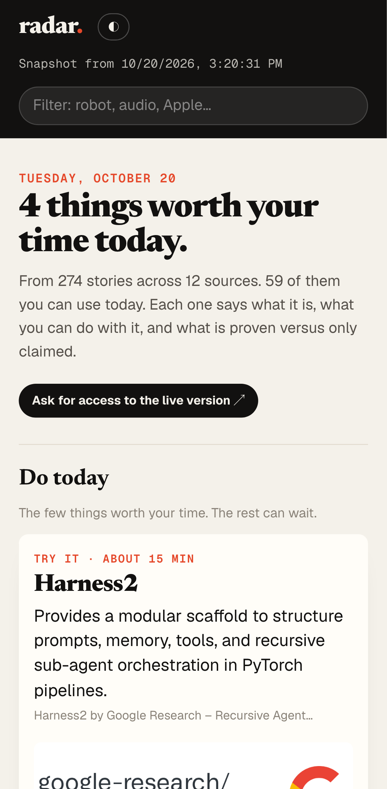
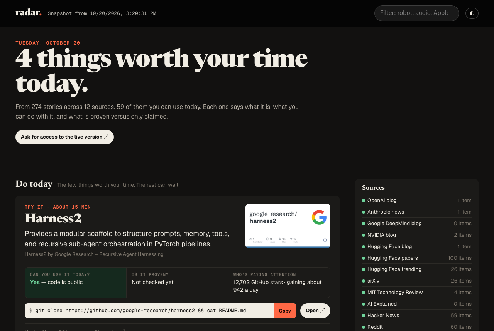

<h1 align="center">radar.</h1>

<b>What's new in AI that you can actually use today, and what's really proven.</b>

  <a href="https://srvstav.github.io/radar/"><b>→ Open radar</b></a> ·
  <a href="https://github.com/srvstav/radar/issues/new?template=request-access.yml">Ask for access</a> ·
  <a href="https://github.com/srvstav/radar/issues/new?template=suggest-source.yml">Suggest a source</a>

## The problem

AI moves every day. Keeping up means a dozen tabs: lab blogs, arXiv, Hugging Face, GitHub, Hacker News, Reddit, YouTube. Most of what you read is hype. And when something real does show up, it's hard to tell whether you can use it yet.

## What radar gives you

Every 10 minutes radar reads all of those at once and merges the same story from different places. Then it opens with **the few things worth your time today**. Every item answers the same three questions:

| | |
|---|---|
| **Can you use it today?** | *Yes, code and weights are public.* Or *Not yet, paper only.* It checks for itself: if there's a GitHub repo, radar knows. |
| **Is it proven?** | What's independently verified versus what the authors only claim. |
| **Who's paying attention?** | *12,702 GitHub stars, gaining about 942 a day.* Real numbers, in words. |

Then the first step, ready to copy: `git clone …`, the command, or the exact section to read.

## How it decides what's useful

- **A written rubric, not vibes.** To score near the top, you must be able to use it today, it must do something new or clearly better, and there must be evidence beyond the authors' word. **Claims without evidence can't score above 6.** Hype words aren't allowed.
- **Your judgment trains it.** Mark items *Useful*, *Not useful* or *Knew it*, and paste anything it missed. radar measures how often it ranks a useful item above a useless one. It switches to a ranking learned from your ratings **only if that ranking does better on ratings it hasn't seen.**
- **Room for the unexpected.** There's a separate view for things rated important that few people are discussing yet, and one for brand-new names and sudden spikes. The ideas that matter most often start out ignored.

  
  &nbsp;&nbsp;
  

## What it reads

OpenAI · Anthropic · Google DeepMind · NVIDIA · Hugging Face (daily papers, trending models, blog) · arXiv · MIT Technology Review · AI Explained · Hacker News · Reddit (r/MachineLearning, r/LocalLLaMA, r/singularity, r/robotics).

It pays special attention to **deep learning, world models and physical AI**. Missing a source you rely on? [Suggest it](https://github.com/srvstav/radar/issues/new?template=suggest-source.yml).

## Use it

- **Look now:** [srvstav.github.io/radar](https://srvstav.github.io/radar/) is a real snapshot from the live engine.
- **The live version** updates every 10 minutes. You can rate items and choose the AI model that writes the explanations: Anthropic Claude, OpenAI, or a free Google Gemini key. It's in private beta: [ask for access](https://github.com/srvstav/radar/issues/new?template=request-access.yml). We open spots in small batches and reply on your issue.

## FAQ

**Is the demo real?** Yes. It's an actual snapshot from the engine, refreshed by hand. The live version updates every 10 minutes.

**Who writes "what it is" and "is it proven"?** An AI model, held to the rubric above. Hard facts it can check, like a public repo or released weights, override its guesses.

**Is it open source?** No. This repo is radar's public home: the demo, the waitlist and the roadmap.

**Where does the content come from?** Public feeds and pages. radar links to the original, and content belongs to its owners.

---
© 2026 srvstav · <a href="https://srvstav.github.io/radar/">srvstav.github.io/radar</a>
